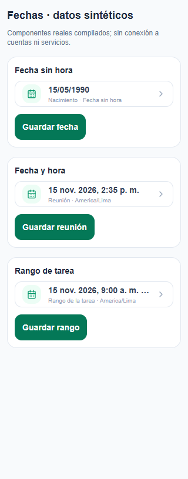
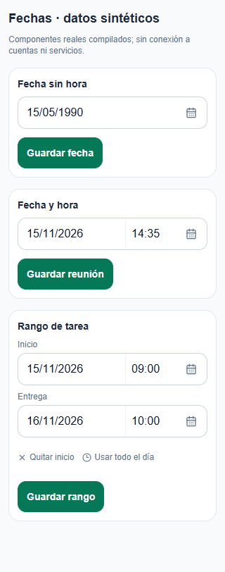
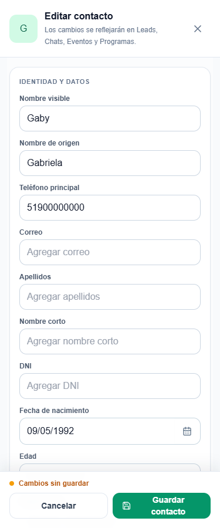

# Fechas editables: comprobación visual y funcional

Se compilan los componentes reales `OperationalDatePicker` y `TaskDateRangePicker` con esbuild y la configuración Tailwind del proyecto. La comparación anterior obtiene los componentes de la revisión fija `c97f663b3855` mediante `git show`, sin modificar el checkout. No se añade ninguna ruta de prueba a la aplicación.

El escenario posterior incluye también `ContactDetailSurface` real. Su perfil, sincronización Google, avatar, etiquetas y servicios son sustitutos sintéticos explícitos; no se usa ninguna cuenta, credencial ni registro real. El navegador bloquea las conexiones que no pertenezcan al servidor local efímero de prueba.

Los escenarios offline montan `OfflineTasksView` real con un gateway sintético. Su bundle CSS contiene el runtime offline y `operational-date/operationalDate.css`, sin Tailwind. El servidor sirve literalmente la política de seguridad de `frontend/scripts/build-offline-v4.mjs`: `default-src 'none'; script-src 'self'; style-src 'self'; img-src 'self' data: blob:; connect-src 'self'; font-src 'self' data:; worker-src 'self'; base-uri 'none'; form-action 'self'`. No se relaja la política para conseguir que la prueba funcione.

## Resultado

- Comparación anterior: 4 disposiciones aprobadas, con capturas en `before/`.
- Componentes actuales: 11 disposiciones aprobadas a 320, 375, 768, 1024 y 1440 px, incluyendo navegación expandida y el ancho ocupado por Eros en escritorio.
- Contacto real: 2 disposiciones aprobadas, a 375 y 1440 px.
- Tareas offline reales sin Tailwind y con CSP original: 3 disposiciones aprobadas, a 320, 375 y 1440 px, sin violaciones CSP.
- Total posterior: **13 escenarios online más 3 offline, todos aprobados**.
- Los resultados y medidas están en `before/report.json` y `after/report.json`.

La matriz verifica texto parcial conservado sin guardar, lectura del último valor completo al guardar con el campo enfocado, fecha ISO exacta, cancelación del calendario, foco restaurado, ausencia de hora en fechas simples, icono sin confirmar el texto, hora existente preservada y aplicación conjunta del rango. En entrada táctil se miden icono y celdas de al menos 44 px. Las capturas del contacto comprueban nacimiento, campo personalizado de fecha, bloqueo de valores incompletos y una sola escritura del formulario completo.

En offline se miden además todos los botones de navegación y pie del calendario con un mínimo táctil de 44 × 44 px. La prueba confirmó el portal fijo dentro de pantalla, los colores y la tipografía heredados del runtime y una única creación local que conserva la fecha tecleada con vencimiento a las 23:59:59 de Lima. La corrección de densidad táctil se limita al CSS propio del control; la CSP permanece idéntica.

La navegación y Eros son columnas de prueba que consumen ancho real; las capturas no representan una sesión autenticada de la aplicación. El almacenamiento y las APIs de producción quedan fuera de esta prueba aislada.

## Reproducir

Desde la raíz del repositorio, con Chrome instalado:

```powershell
$env:PLAYWRIGHT_CHANNEL = 'chrome'
node tests/operational-dates-browser.mjs --baseline
node tests/operational-dates-browser.mjs
```

`--only=contact` repite los dos escenarios de contacto y conserva las once comprobaciones previas del informe. Los bundles temporales y el servidor local se crean bajo `.qa/operational-dates-browser/`; las evidencias compartibles quedan en esta carpeta.

`--only=offline` repite los escenarios offline a 320, 375 y 1440 px y conserva los escenarios online del informe. Comprueba ausencia de violaciones CSP, posición fija del portal, límites del viewport, fuente y colores, controles táctiles, selección sin escritura hasta Aplicar, Escape y guardado local de la última fecha tecleada a las 23:59:59 de Lima.

Las unitarias focalizadas adicionales cubren Admin, creación de aplicación de encuesta y encuesta pública: 14 pruebas aprobadas. Verifican años bisiestos, fechas imposibles o parciales, rangos existentes, fallos de red sin pérdida del borrador, Enter sin envío accidental y conservación de la fecha al avanzar entre preguntas. Volver atrás con una fecha incompleta conserva la pregunta y el texto; con una fecha válida, volver atrás y avanzar de nuevo conserva su valor ISO aunque el campo no haya perdido el foco.

La regresión de campañas añade dos casos con la interfaz real: al recoger «Programar envío» una fecha incompleta permanece en su campo y bloquea la acción, tanto con una programación previa como sin ella. Corregir la fecha y volver a recoger permite reprogramar una sola vez con el último valor. Estos dos casos y la regresión existente de suspensión de campaña aprobaron conjuntamente (3/3).

## Comparación visual

| Antes | Después |
| --- | --- |
|  |  |

La fecha de nacimiento dentro del editor real de contacto:



## Inventario

`node tests/operational-date-inventory.mjs` recorre los nodos JSX mediante TypeScript y genera `inventory.json`: cero entradas nativas de fecha y 67 apariciones de los controles compartidos. Son apariciones en código, no un número de pantallas ni de campos en ejecución.

## Verificación de entrega

Ejecutada con Node.js 24.22.3:

- Suite completa: 486 archivos y 3188 pruebas de aplicación aprobados; 62 pruebas del editor integrado y 48 de scripts aprobadas.
- Tras los últimos ajustes de foco y adaptación: 127 pruebas de los formularios afectados y 45 de fecha/rango/distribución aprobadas; también pasó la comprobación dirigida de quitar sólo el inicio.
- Tipado completo y compilación de producción aprobados. El build verificó nueve artefactos CSS, los paquetes offline y la integridad y marca del editor integrado.
- Navegador final: 16 escenarios aprobados, cero violaciones CSP y lectura completa medida en cada campo; cuatro disposiciones anteriores conservadas para comparar.
- Inventario final: cero controles nativos de fecha y 67 apariciones de los controles compartidos.

Los resúmenes reproducibles están en `verification.json`, `inventory.json` y los dos informes de navegador. Las APIs, el esquema, el almacenamiento y la política de sesión conservan sus contratos. Esta entrega corresponde a implementación y PR; no se efectuó despliegue.
