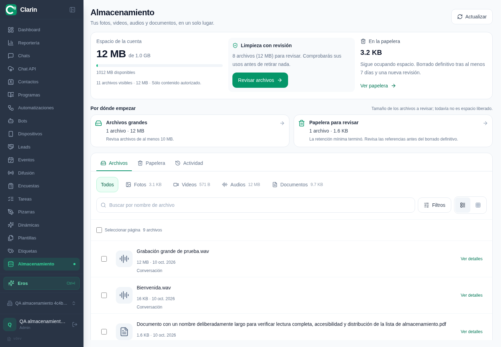

# Almacenamiento: ampliación por usos y QA local

Código final verificado: `ffcadbdde92253cb092e947446ac7d9182a3409e`. Backend, runner nativo, navegador y rendimiento corresponden a esta revisión. La suite completa, TypeScript y build del frontend se ejecutaron sobre `69a5ae4`; después sólo cambiaron tres archivos Go, sin modificar ese frontend. La prueba de migraciones con datos previos se ejecutó sobre `7822cda`, sin cambios posteriores en las migraciones. Documentación y evidencias se incorporan después en un commit separado.

Esta entrega amplía la autogestión desde medios exclusivos de Chats a usos concretos de medios autorizados. Clarín se ejecutó en el entorno local con PostgreSQL 16, Redis y MinIO reales, usando la aplicación frontend compilada y cuentas sintéticas.

## Resultados del pase final

| Comprobación | Resultado |
| --- | --- |
| Backend completo | PASS: `GOCACHE=/tmp/go-build GOMAXPROCS=2 go test -p 2 ./...`. |
| Migraciones PostgreSQL e idempotencia | PASS: `TestCRMMigrationDirtyAndIdempotent`, 5,659 s; incluye datos previos incompatibles y una segunda aplicación. |
| Compilación del servidor | PASS; el proceso local ejecuta exactamente el binario compilado, comprobado por inode. |
| Frontend completo | **1.801 PASS**: 1.729 pruebas principales en 303 archivos, 28 del fork del editor y 44 de Node. |
| Frontend build y TypeScript | PASS. Se ejecutó la aplicación compilada y se conservaron los metadatos del checkout. |
| Runner con PostgreSQL/MinIO/Redis reales | **109 comprobaciones hoja PASS**, 123 contando grupos padre; **0 omisiones**. PostgreSQL 16.15, Redis 7.4.11 y MinIO RELEASE.2025-09-07T16-13-09Z. Runner final íntegro, exit 0. |
| Navegador Chromium | **25/25 PASS en 60,901 s**, sin reintentos ni omisiones: seis casos con servicios reales y 19 con API simulada. Chromium 151, aplicación compilada. Incluye geometría de nombres y acciones en Archivos a 320/375 px y en Papelera a 375 px. |
| Comprobación SQL/MinIO y limpieza del fixture | **12/12 PASS**. Restauración de 1.655 bytes con hash original; purga de 1.653 bytes físicamente ausente; textos conservados. Limpieza de los 11 objetos restantes (12.612.702 bytes); recuento final **0**. |
| Entorno general | PASS: salud PostgreSQL/Redis, login, consultas autenticadas, proxy HTTP, S3 y WebSocket autenticado 101. |

Los checks estándar que omiten integraciones opcionales no se presentan como prueba de esas integraciones. Los resultados nativos de esta tabla se obtuvieron ejecutando sus flags y servicios reales. Los logs privados quedan fuera de los artefactos publicados.

## Rendimiento medido

**25/25 escenarios aprobados**, con diez muestras por escenario y dos calentamientos. Todas las muestras y lotes adicionales de memoria registraron **cero peticiones S3** mediante un contador del proxy real. Los hashes de los 686 archivos Go permanecieron iguales durante la medición. La verificación posterior confirmó cero bases desechables y cero objetos restantes en los buckets de prueba, conservando los servicios generales.

Los datos sintéticos principales son 1.000, 10.000 y 50.000 objetos de 1 KiB, una referencia de medio y diez mensajes de texto adicionales por objeto, repartidos entre 100 Chats. Un escenario separado usa un archivo en 10.000 mensajes de 101 Chats. Se ejecutan handlers reales con PostgreSQL y MinIO nativos e identidad sintética; la latencia no incluye navegador, login ni transporte remoto HTTP/TLS.

Mediciones de **miembro**, en milisegundos para latencia y MiB para memoria:

| Objetos | Archivos p50 / p95 | Resumen + Archivos p50 / p95 | Asignación Go p50 por apertura | Pico RSS Go al abrir |
| ---: | ---: | ---: | ---: | ---: |
| 1.000 | 59,38 / 79,04 | 68,72 / 82,62 | 0,53 | 33,36 |
| 10.000 | 637,29 / 715,68 | 613,20 / 684,78 | 0,53 | 37,76 |
| 50.000 | 3.250,92 / 3.584,05 | 3.324,07 / 3.450,42 | 0,53 | 38,28 |

Mediciones de **administrador**, sobre el mismo inventario de Chats y manteniendo los predicados de permisos:

| Objetos | Archivos p50 / p95 | Resumen + Archivos p50 / p95 | Asignación Go p50 por apertura | Pico RSS Go al abrir |
| ---: | ---: | ---: | ---: | ---: |
| 1.000 | 91,98 / 501,60 | 395,33 / 592,06 | 5,37 | 39,97 |
| 10.000 | 699,27 / 778,97 | 733,12 / 1.231,71 | 5,36 | 42,24 |
| 50.000 | 3.647,90 / 3.813,68 | 3.723,88 / 3.908,65 | 5,37 | 42,73 |

El caso de **un archivo con 10.000 usos** también aprobó después de corregir la comparación de referencias:

| Consulta | p50 / p95, ms |
| --- | ---: |
| Archivos | 252,19 / 279,57 |
| Resumen | 139,66 / 149,74 |
| Resumen + Archivos | 243,42 / 279,09 |
| Detalle de usos | 2.305,64 / 2.740,03 |

El detalle de esos 10.000 usos todavía materializa todas las coincidencias antes de paginar: asignó 206,53 MiB por consulta y alcanzó 70,08 MiB de RSS Go muestreado. La mejora del listado no elimina ese coste del detalle.

La creación del fixture y la indexación se midieron aparte de las consultas:

| Objetos | Preparación del fixture, s | Indexación inicial drenada, s |
| ---: | ---: | ---: |
| 1.000 | 18,09 | 0,45 |
| 10.000 | 107,95 | 4,69 |
| 50.000 | 470,98 | 41,75 |

La indexación usa el reconciliador real de forma explícita, sin la espera de dos segundos entre ciclos del trabajador de fondo. No es una medición de cuánto tardará una cuenta nueva en quedar lista mediante ese trabajador. La preparación incluye las escrituras reales del fixture y su validación; `ANALYZE` y las validaciones de respuestas están fuera de las muestras de latencia.

Con diez muestras, p95 coincide con el máximo. Resumen + Archivos lanza ambas consultas en paralelo; no representa usuarios simultáneos sostenidos. Las asignaciones son acumuladas por lote, no memoria retenida. RSS y heap se muestrean cada 10 ms en un lote adicional, tras GC y liberación explícita de memoria: corresponden sólo al proceso Go, pueden omitir picos breves y excluyen PostgreSQL, Redis y MinIO.

En 50.000 objetos, la apertura para un miembro tuvo una mediana de **3,32 s**, asignó **0,53 MiB** y alcanzó **38,28 MiB de RSS Go muestreado**. La medición histórica del recorrido completo registraba 2,57 s, 1.112,8 MiB asignados y 253,5 MiB de RSS. Son ejecuciones e implementaciones distintas, no un experimento A/B contemporáneo: acreditan un coste de memoria mucho menor en esta medición, pero **no una mejora universal de latencia**. Las agregaciones exactas, la búsqueda y los offsets todavía dependen del volumen y de los permisos.

El JSON conserva los 25 resultados, entorno, semilla, índices, método completo y hashes: [mediciones reproducibles](storage-self-service-expanded-performance-20261010.json). No se midió el consumo de producción ni se certifica un SLA.

## Objetivos y comportamiento entregado

| Objetivo | Resultado |
| --- | --- |
| Una entrada comprensible | Una opción de Almacenamiento, con Archivos, Papelera y Actividad. Sólo fotos, vídeos, audios y documentos autorizados. |
| Saber qué ocupa espacio | Resumen de medios, filtros por tipo, tamaño, antigüedad y origen; listado y cuadrícula, recomendaciones explicadas y detalle de ubicaciones. El administrador ve el agregado de objetos observados por el índice, con su frescura; no tablas, logs, copias ni todo el disco. Los demás actores sólo ven sus medios autorizados. |
| Gestionar un uso sin romper otro | Selección por uso para Chats, campañas borrador, respuestas rápidas, stickers, fotos de Contactos, adjuntos de Work e imágenes editables de Pizarras. Los usos ajenos se conservan. |
| Gestionar cargas abandonadas | Sólo cargas propias con procedencia verificada, sin uso y con al menos 24 horas. Un objeto antiguo deduplicado no adquiere procedencia por deduplicarse. |
| Evitar pérdidas y errores | Revisión previa vinculada a la selección, revalidación, recuperación mínima de siete días, purga manual y operaciones durables e idempotentes. Restaurar no sustituye contenido posterior. |
| Aislar cuentas y recursos | Consultas, descargas, operaciones y cachés acotados por cuenta y actor; Work y Pizarras resuelven sus permisos actuales por recurso. El aviso genérico `storage_changed` llega a toda la cuenta sin datos de archivos; los eventos con contenido siguen la ACL de su módulo. |
| Reducir el coste del inventario | Índice persistente con filtros y paginación SQL. Trabajador incremental; Archivos y Uso no enumeran S3 ni materializan todo el inventario en Go. Medición separada del coste de indexación inicial. |
| Diagnosticar una cuenta concreta de producción | No medido. Los resultados y las cifras de este informe pertenecen exclusivamente al laboratorio local. |

Los límites por módulo forman parte del contrato: campañas activas/programadas, revisiones históricas, bibliotecas y otras referencias protegidas no se modifican para forzar la liberación de bytes. Los logs, tablas, copias y archivos técnicos siguen bajo gestión del administrador del servidor.

## Qué significa liberar espacio

Retirar un uso conserva los bytes y los demás usos. Si coexisten la recuperación anterior y una nueva del mismo objeto, primero debe resolverse esa coexistencia: ambas purgas permanecen bloqueadas. La recuperación sigue contando como espacio ocupado. La purga exige que termine la retención pertinente y que una nueva comprobación no encuentre referencias, incluidas las que el actor no puede consultar. Una respuesta perdida de S3 o un fallo de finalización SQL mantiene una intención persistente para reintentar; no se declara espacio liberado sin evidencia.

## Entorno y reproducción

El entorno general local conserva PostgreSQL, Redis, MinIO y Clarín independientes del laboratorio desechable de integración. El helper reutilizable verifica autenticación, proxy frontend/API y acceso S3. La aceptación visual usa `next start`; no se debilitó la CSP para ejecutar el login.

El runner `scripts/qa/run-storage-self-service.sh` crea servicios propios en loopback y limpia sólo sus datos. Los datos de navegador se crean con `backend/cmd/storage-ui-qa`, cuyo manifiesto privado limita la verificación y limpieza a las cuentas y objetos generados.

## Límites de la evidencia

- Los seis recorridos de navegador real se concentran en Almacenamiento y usos compartidos con Chats/respuestas rápidas. Los otros módulos se cubren mediante sus adaptadores, repositorios, SQL, S3 y pruebas unitarias; no se recorrió cada editor completo en navegador.
- Las anchuras móviles se simulan en Chromium de escritorio. No se certifican Android/iOS reales, Firefox, WebKit ni lector de pantalla.
- La retención se comprueba adelantando exclusivamente las fechas de fixtures sintéticos; no se esperaron siete días naturales.
- Las pruebas de fallos aplican errores controlados de S3/SQL y confirmaciones perdidas. No simulan todos los cortes de red, caídas del host ni servicios lentos sostenidos.
- El volumen medido corresponde a Chats y a un objeto compartido en muchos mensajes, incluyendo un administrador sobre ese inventario. No representa 50.000 adjuntos privados de Work/Pizarras ni sus jerarquías y concesiones.
- El índice elimina el recorrido S3 del listado. Las agregaciones SQL dependen de la distribución autorizada y el detalle de usos todavía carga sus coincidencias antes de aplicar cursor. La medición sintética no certifica capacidad ni SLA de producción.
- No se ha medido almacenamiento de producción. No se atribuyen cifras sintéticas a ninguna cuenta real.

## Correcciones encontradas durante la QA

- **Recuperación de datos anteriores:** una retirada nueva no sobrescribe los backups, el actor ni la retención de la papelera anterior. Las dos recuperaciones siguen siendo restaurables en ambos órdenes. La coexistencia bloquea ambas purgas hasta resolverla; ninguna omite la recuperación del otro registro.
- **Permisos después de retirar:** una marca física sin backups no concede acceso por sí sola. Las vistas previas y descargas de recuperaciones aplican el permiso actual del módulo, también después de revocarlo.
- **Conversión frente a retirada en Work:** el publicador toma primero la barrera de cuenta y después el bloqueo del adjunto. Si fue retirado mientras se convertía, no publica el derivado. La prueba usa transacciones PostgreSQL concurrentes del helper real; no acredita una conversión LibreOffice completa.
- **Respuestas antiguas en el detalle de tarea:** las peticiones de adjuntos anteriores a una retirada no pueden reintroducir tarjetas obsoletas. Las regresiones reproducen ambas carreras con respuestas diferidas, conservando borradores y restauración.
- **Recolectores y fallos parciales:** una eliminación aplicada en S3 con respuesta perdida conserva una intención durable. Se impide reutilizar el mismo objeto durante el borrado y se evita contar dos veces los bytes al reintentar.
- **Nombres y datos compartidos:** el nombre de un archivo deduplicado se deriva de sus usos autorizados o de la carga propia; un nombre de un recurso oculto no aparece en el listado ni en la búsqueda.
- **Un archivo con 10.000 usos:** la prueba de volumen encontró un timeout de 45 segundos en el listado y la apertura conjunta. `EXPLAIN` mostró una comparación anidada de referencias físicas y autorizadas. Se sustituyó por una diferencia de conjuntos con la misma cuenta, permisos, generación y excepción de cargas propias. La regresión nativa comprueba 10.000 usos, referencias ocultas, concesión/revocación de permisos y cargas propias/ajenas, sin aumentar el timeout. El intento fallido se conserva como diagnóstico y no se presenta como un pase aprobado.
- **Legibilidad de archivos en móvil:** la inspección de capturas detectó que una acción lateral dejaba demasiado estrecho el nombre y partía palabras. En la lista móvil, la acción pasa debajo del texto y el nombre aprovecha el ancho disponible, sin truncarse. La QA mide el espacio de lectura, posición y área táctil de la acción.
- **Restauración visible en el laboratorio:** el entorno servía Next directamente sin reenviar `/ws`. La captura mostró HTTP 200 para restaurar, SQL/S3 correctos, cero eventos y un listado que permanecía en indexación. El gateway local de HTTP/WebSocket resolvió el caso con la misma aplicación, las mismas aserciones y el mismo timeout. El arranque reutilizable verifica ahora el handshake autenticado 101.

## Reproducción de la aceptación de navegador

Con el entorno local levantado y sus variables privadas activadas, usar un manifiesto **nuevo** dentro de `work/`; no imprimir su contenido ni publicarlo:

```bash
source /workspace/clarin-cloud/activate.sh
cd /workspace/clarin/backend
CLARIN_STORAGE_UI_QA=1 go run ./cmd/storage-ui-qa \
  -action create -manifest ../work/storage-ui-qa/repeat.private.json \
  -assets ../tests/fixtures/storage
cd ..
CLARIN_QA_CHROMIUM_PATH=/usr/bin/chromium \
PLAYWRIGHT_BASE_URL=http://localhost:3000 CLARIN_STORAGE_BROWSER_QA=1 \
CLARIN_STORAGE_UI_QA_MANIFEST=work/storage-ui-qa/repeat.private.json \
  npx playwright test --config=playwright.storage.config.ts
cd backend
CLARIN_STORAGE_UI_QA=1 go run ./cmd/storage-ui-qa \
  -action verify -manifest ../work/storage-ui-qa/repeat.private.json \
  -expect restore=active,purge=purged
CLARIN_STORAGE_UI_QA=1 go run ./cmd/storage-ui-qa \
  -action cleanup -manifest ../work/storage-ui-qa/repeat.private.json
```

La limpieza verifica la titularidad del fixture y actúa sólo sobre sus cuentas y prefijos. Si una prueba falla, conservar primero la evidencia del fallo, verificar los estados efectivos y limpiar utilizando su propio manifiesto. No exigir estados de éxito a un escenario que no llegó a ejecutarse.

## Capturas de la aplicación



| Evidencia | Captura |
| --- | --- |
| Usos autorizados y compartidos | [Detalle del archivo](storage-self-service-expanded-20261010/03-archivo-compartido-protegido.png) |
| Impacto antes de confirmar | [Revisión](storage-self-service-expanded-20261010/06-revision-antes-de-retirar.png) |
| Retirar Chat conservando respuesta rápida | [Un uso seleccionado, otro conservado](storage-self-service-expanded-20261010/14-retirada-uso-compartido.png) |
| Resumen accesible al miembro, sin cuota global | [Móvil](storage-self-service-expanded-20261010/11-movil-resumen.png) |
| Nombres completos y acciones cómodas en móvil | [Lista móvil](storage-self-service-expanded-20261010/12-movil-archivos.png) |
| Confirmación y teclado en móvil | [Revisión móvil](storage-self-service-expanded-20261010/13-movil-revision.png) |

La galería descargable incluye las 14 capturas originales, los estados HTTP sin credenciales, la verificación saneada SQL/MinIO, las mediciones y sus hashes. Las capturas proceden del mismo pase final; no son maquetas.
