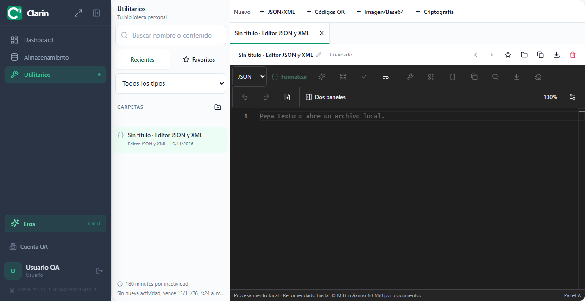
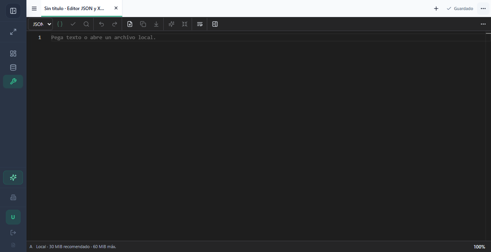

# Utilitarios: espacio de trabajo compacto

## Alcance

Presentación y navegación de JSON/XML, QR, Imagen/Base64 y Criptografía. Menú principal de 68 px exclusivo de Utilitarios, biblioteca inicialmente recogida, cabecera común de 44 px y herramientas distribuidas según el espacio real disponible. Las únicas preferencias nuevas del navegador son dos valores de disposición visual por cuenta y usuario.

No se modifican APIs, esquema, almacenamiento de documentos, cifrado ni política de sesión. El cambio de distribución conserva modelos, historial y borradores. Las opciones secundarias se consultan a demanda y las contraseñas continúan fuera del autoguardado.

## Comparación medida

Viewport CSS 1263 × 650, DPR 1, entrada con ratón, un panel JSON, biblioteca y Eros cerrados en la distribución nueva. Datos sintéticos; mismo navegador y tamaño legible de texto.

| Distribución | Editor | Superficie |
| --- | --- | --- |
| Anterior, con navegación y biblioteca iniciales | 765 × 391 px | 299 115 px² |
| Compacta por defecto | 1195 × 541 px | 646 495 px² |

Se recuperan 430 px de ancho y 150 px de alto; el área del editor aumenta aproximadamente un 116 %. La cabecera nueva ocupa 44 px y la barra JSON con ratón 36 px. La aceptación exigía al menos 1150 × 500 px.

| Utilitario | Escritorio | Pantalla de 320 px |
| --- | --- | --- |
| JSON/XML | [Captura](utilities-compact-20261115/json-1263.png) | [Captura](utilities-compact-20261115/json-320.png) |
| QR | [Captura](utilities-compact-20261115/qr-1263.png) | [Captura](utilities-compact-20261115/qr-320.png) |
| Imagen/Base64 | [Captura](utilities-compact-20261115/imagen-base64-1263.png) | [Captura](utilities-compact-20261115/imagen-base64-320.png) |
| Criptografía | [Captura](utilities-compact-20261115/criptografia-1263.png) | [Captura](utilities-compact-20261115/criptografia-320.png) |

La misma referencia con entrada táctil conserva 1195 × 513 px de editor, con controles de 44 px. Los controles para ratón miden 32 px; el zoom del navegador permanece al 100 %.

## Verificación

- TypeScript: aprobado.
- Suite unitaria general final: 3093 pruebas aprobadas en 466 archivos.
- Pruebas focalizadas: biblioteca y preferencias 59; JSON 63; criptografía, bóveda y operaciones cancelables 34; imágenes 15; CSS compacto compilado 1.
- Complementos de la suite: editor de pizarras 62; comprobaciones de seguridad, estilos, licencias y recursos 48. Aprobados.
- Compilación de producción: aprobada, incluida la verificación de CSS interactivo y recursos empaquetados.
- Navegador sobre el paquete final de producción: 35/35 escenarios aprobados sin reintentos. Biblioteca e imágenes 11; JSON/XML 14; matriz de disposición y claves 10.
- Matriz: los cuatro utilitarios a 320, 375, 768, 1024, 1263 y 1440 px con ratón y entrada táctil; biblioteca y Eros abiertos y cerrados. Se midieron controles, una sola fila, ausencia de desbordamiento general y menús dentro de la pantalla.
- Regresiones: pestañas, autoguardado, conflictos, reapertura, eliminación, codificaciones, archivos de 25–30 MiB, historial, comparación, zoom 500 %, QR, imágenes, claves AES/EC, CSR, certificados, JWT y exportación P12. Guardar un CSR conserva la sección y su borrador durante la actualización de metadatos.
- Teclado: recorrido de menús, End, Escape y devolución de foco. Escape de la biblioteca conserva Eros abierto, tanto con foco en búsqueda como en cabecera. Todas las opciones del menú miden 32 px con ratón y 44 px táctiles.
- Identificación de claves: las pruebas de componente comprueban el nombre junto con el algoritmo después de Usar, manteniendo únicamente la referencia de clave en el autoguardado.

Las pruebas de navegador utilizan APIs simuladas y acreditan el comportamiento del cliente, no escrituras reales en bibliotecas de usuarios. La comprobación del despliegue verifica por separado salud, versión, registros y recursos publicados.

La última ronda, ejecutada junto con la suite general, abrió el XML de 30 MiB en 9,4 s y completó la búsqueda en 4,9 s, incluidos los 500 ms de espera. También verificó ediciones lejanas, deshacer y descarga. Los tiempos dependen del equipo y de su carga; no son un límite garantizado.
