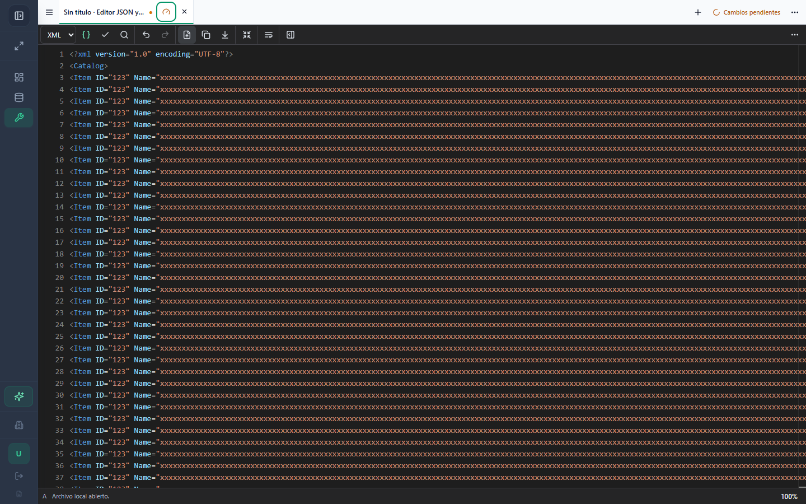
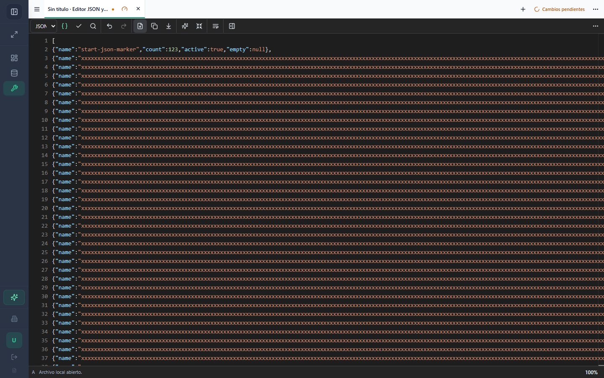
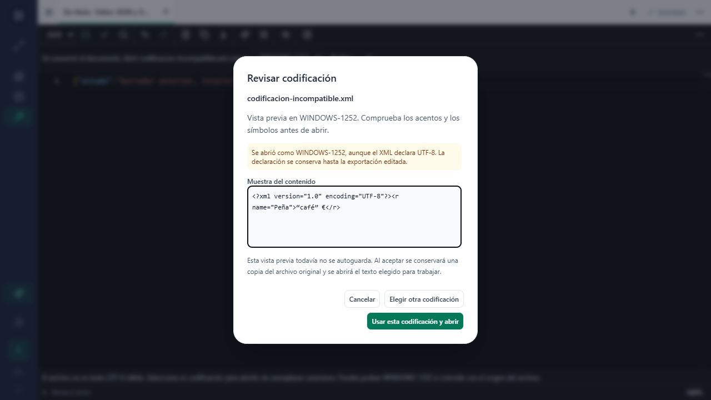
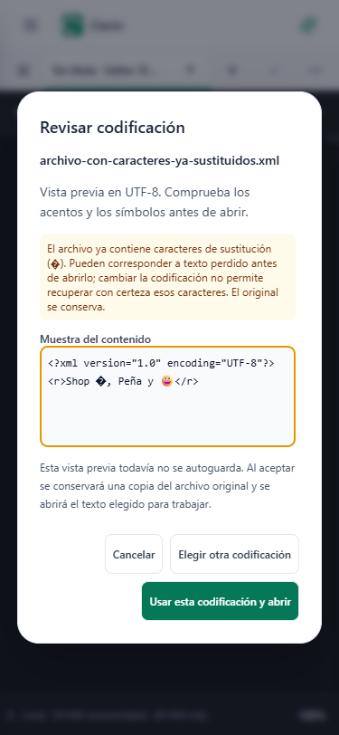

# Utilitarios: color en documentos grandes e importación segura

## Comportamiento

- El modo ligero de un panel ya no cambia todo JSON/XML a texto sin color. XML conserva su tokenizador; JSON/JSONC grandes usan un tokenizador léxico local sin árbol sintáctico ni servicio semántico. Las líneas gigantes mantienen la edición segura por tramos.
- Sólo los paneles que superan los límites actuales entran en modo ligero. La pestaña muestra un indicador con explicación accesible y vuelve al estado normal al reducirse el documento. Los modelos, el historial y el otro panel se conservan.
- La lectura sigue siendo estricta. UTF-8 inválido puede ofrecer Windows-1252 como candidato; una declaración XML antigua con bytes UTF-8 requiere una elección explícita. Una selección manual, conversión o advertencia abre una vista previa antes de sustituir el panel.
- La vista previa y su cancelación no escriben contenido. Un carácter `�` que ya existe en el archivo se advierte sin prometer reconstrucción.
- Al aceptar, el original se conserva como bytes opacos en `original-a/b`; el texto editable se guarda por separado en UTF-8. El original debe guardarse primero, incluso si la importación ocurre durante otro guardado. Un error en su respaldo detiene el guardado del texto importado y conserva el reintento.
- Los paneles almacenados se restauran explícitamente como UTF-8, aunque el XML conserve su declaración de origen. La descarga del original conserva sus bytes.

No cambia APIs, esquema, cifrado, límites de archivo ni política de sesión. Los diagnósticos JSON automáticos que no se mostraban quedan desregistrados para evitar un parseo innecesario; la validación explícita sigue disponible.

## Verificación

- Unitarias de todos los utilitarios: **33 archivos, 193 pruebas aprobadas** en la versión final.
- Carrera de autoguardado y reintentos: **25 pruebas aprobadas**, incluidas dos variantes con un PUT anterior retenido.
- Indicador: **1 prueba aprobada** tras verificar el cierre de su explicación al volver al modo normal.
- Tipado final (`tsc --noEmit --incremental false`): aprobado.
- Compilación completa de producción (`npm run build`): aprobada, incluidas comprobaciones CSS y de artefactos existentes.
- Nuevas pruebas de Chrome: **5 aprobadas**, con XML 20 MiB, JSON 30 MiB, independencia de paneles e historial, elección y cancelación de codificación, original intacto, restauración y móvil táctil de 375 px.
- Regresiones de navegador de todos los utilitarios: **35 aprobadas y 1 omitida**. La omitida sólo captura la distribución anterior al activar el modo de comparación; no corresponde a una función del producto. Con las cinco pruebas nuevas: **40 aprobadas**.

Las pruebas de navegador usan la compilación de producción, trabajadores reales y una API privada simulada con persistencia en memoria. No son una comprobación de la cuenta ni del archivo real del usuario.

Tiempos observados en esta máquina, sin garantía para otros equipos:

| Archivo | Apertura | Espera adicional hasta comprobar color | Colores visibles |
| --- | ---: | ---: | ---: |
| XML 20 MiB | 2690 ms | 268 ms | 5 |
| JSON 30 MiB | 3712 ms | 374 ms | 5 |

Las descargas completas coincidieron mediante SHA-256. En JSON se verificó además una edición seguida de deshacer; no se observaron llamadas a los métodos semánticos vigilados durante las cargas grandes.

## Capturas

El estado del despliegue se registra en la PR; estas capturas corresponden a la compilación local de producción.

## Límites

- No se puede recuperar con certeza texto que ya llegó sustituido por `�`.
- La codificación propuesta es una opción para revisar, nunca una conversión aceptada por silencio.
- Las líneas excepcionalmente largas pueden requerir texto simple por tramos; el indicador lo explica. El color no equivale a validación.
- El respaldo conserva el original de la importación actual de cada panel; no añade un historial ilimitado de archivos originales.
