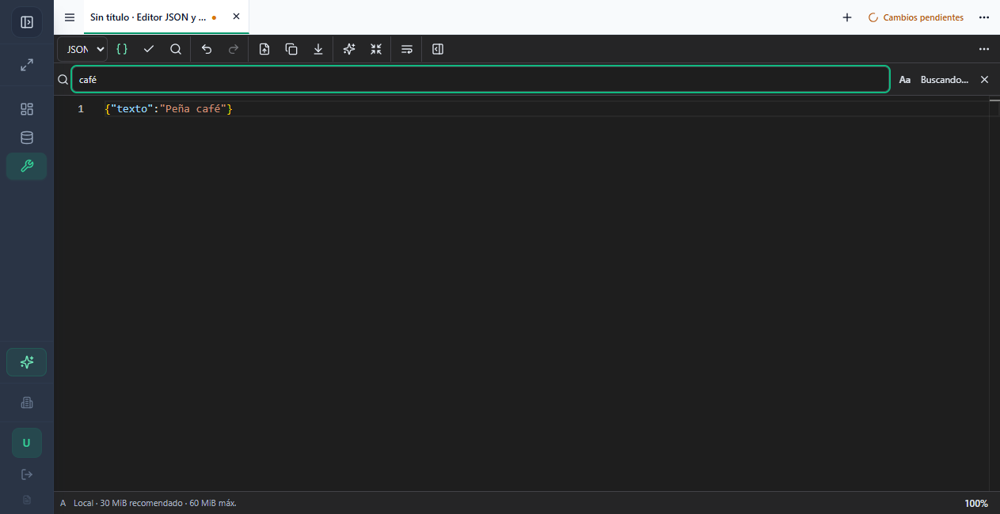
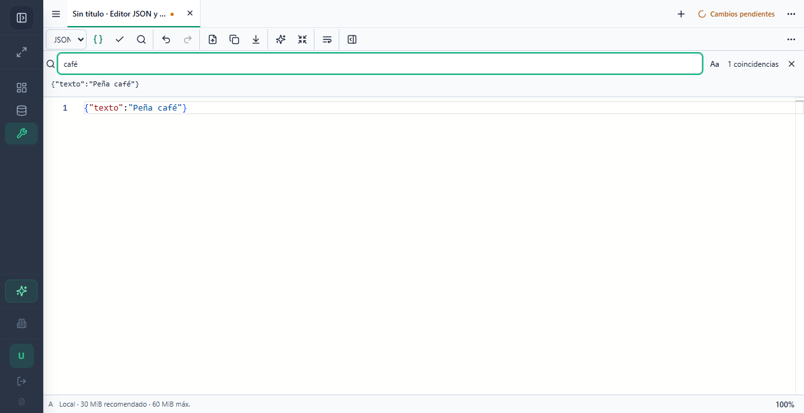
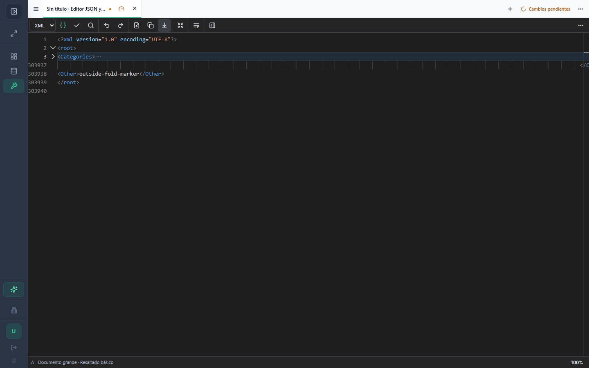
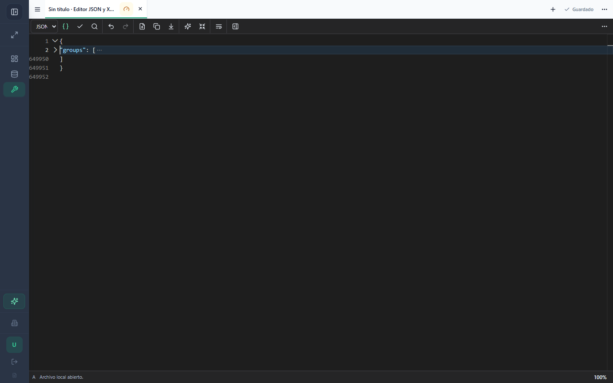
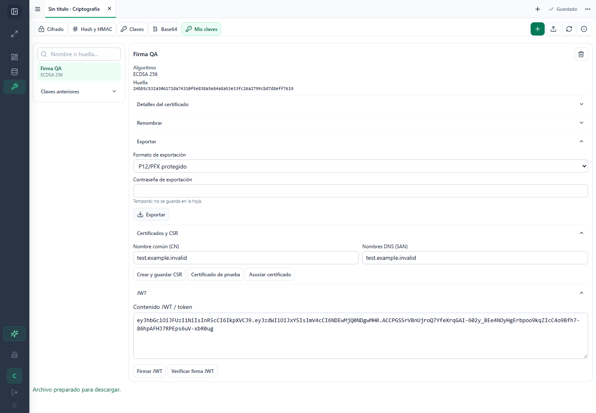

# Buscador, plegado y claves por archivo

## Cambios

- Los campos propios del editor respetan el tema oscuro/claro incluso frente al color global de formularios. Texto, cursor, placeholder y selección mantienen contraste mínimo 4,5:1; Monaco y los diálogos claros conservan sus estilos.
- JSON/JSONC/XML grandes recuperan plegado estructural local sin depender de la sangría ni construir un AST. El trabajador recibe bloques de 64 Ki caracteres con ACK, espera 500 ms sin cambios y tiene límite de 10 s, 5000 regiones y profundidad 160. El proveedor público de Monaco devuelve inmediatamente una caché de la revisión actual; las respuestas obsoletas se descartan.
- Se conservan pliegues, historial, selección y desplazamiento entre paneles y cambios de ancho. Las capturas de vista se agrupan cada 250 ms y respetan el presupuesto existente de autoguardado. El indicador explica preparación y límites; las vistas por tramos mantienen su restricción.
- Cada clave nueva pertenece a una hoja de criptografía. Las APIs comprueban cuenta, usuario, documento y clave, incluidos los replays idempotentes. Las rutas globales de material quedan cerradas.
- Duplicar una hoja crea claves con IDs, objetos y envelopes independientes, conservando su material, certificados y CSR. Borrar una hoja programa también la limpieza de sus claves. Borrar una clave seleccionada reconcilia la versión canónica sin perder preferencias locales ni una selección posterior.
- El esquema añade propiedad documental e índice paginado; el legado ajeno permanece disponible sólo como metadata para recuperación explícita hacia una hoja. No cambia el cifrado v1, los límites de contenido ni la política de sesión.
- La limpieza de claves anteriores es un comando interno separado de las migraciones: identidad exacta, dry-run, manifiesto privado, digest, CAS, auditoría y reanudación por cuenta. No lee ni imprime material criptográfico. Su ejecución y verificación de almacenamiento activo se registran en la PR.

## Verificación

- Compilación completa y actualización final de producción: aprobadas, incluidas comprobaciones CSS y de artefactos existentes.
- Tipado final sin incremental: aprobado, ejecutado después de generar los tipos de producción.
- Regresión inicial de utilitarios: 38 archivos / 218 pruebas aprobadas. Foco final de criptografía y reconciliación: 8 archivos / 77 pruebas; plegado y preferencias: 17 pruebas.
- Suite completa del frontend: **474 archivos / 3148 pruebas de aplicación**, además de **62 pruebas del editor integrado y 48 de scripts**, todas aprobadas.
- Comando de limpieza: modo dry-run e identidad obligatoria, confirmación/digest antes de la base de datos; tres pruebas principales y once subcasos aprobados.
- Backend: paquetes de producto de `go test ./...` aprobados en Windows; las pruebas de archivos de `cmd/storage-ui-qa`, que requieren permisos de Linux, aprobadas mediante su testbin Linux.
- PostgreSQL y MinIO temporales, aislados y sin datos reales: migración repetida, FK, aislamiento, copia de dos claves, legado, borrado y eliminación de todas las versiones físicas de objetos aprobados. Se verificaron también reservas concurrentes de cuota y eliminación de cuenta encolada.
- HTTP real sobre esos servicios aislados: creación/listado/material, cruces entre hojas/usuarios/cuentas, duplicación/replay, ciphertext y envelope independientes y DELETE con versión canónica aprobados.
- Chrome sobre compilación de producción: **44 pruebas aprobadas**; una captura opcional de la distribución anterior omitida. Incluye contraste, XML 20 MiB, JSON 30 MiB, búsqueda dentro de pliegues, panel B, 375–1440 px, autoguardado tras eliminar claves, duplicados independientes, QR, imágenes, codificaciones y regresiones de biblioteca.

Las pruebas de navegador utilizan trabajadores y criptografía reales con APIs simuladas. La integración HTTP utiliza la API real con PostgreSQL/MinIO desechables y una identidad sintética; ninguna prueba funcional utiliza datos de una cuenta real. El estado de despliegue se registra en la PR.

## Capturas

